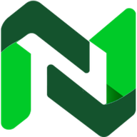
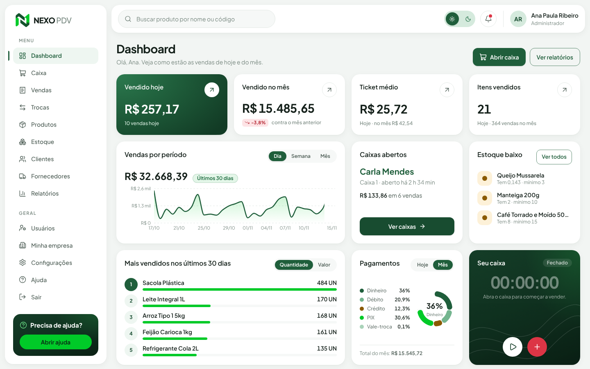
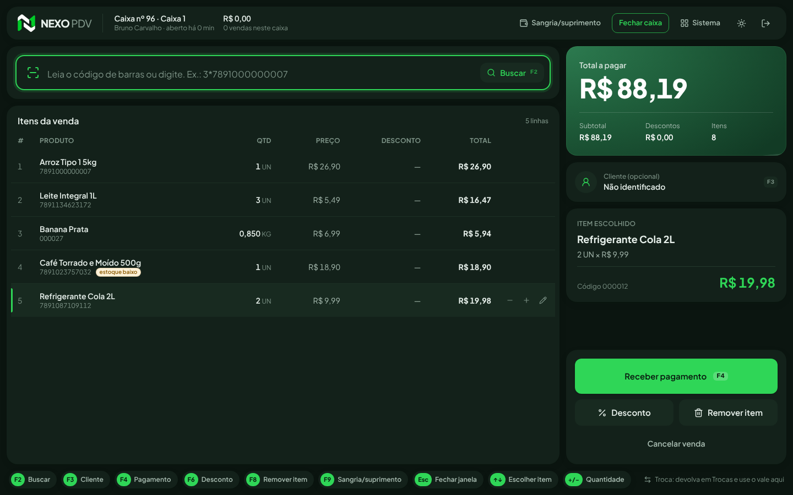

<p align="center">
  
</p>

# NEXO PDV

Ponto de venda gratuito para mercadinho, loja de bairro e pequeno comércio. Roda no computador da loja, abre no navegador e funciona nos outros computadores da mesma rede.

Página do projeto: https://thiagopfreire160.github.io/nexo-pdv/



## O que ele faz

- **Frente de caixa** em tela cheia, com leitor de código de barras, venda por peso, atalhos de teclado e pagamento dividido entre dinheiro, débito, crédito, PIX e vale-troca.
- **Abertura e fechamento de caixa** com fundo de troco, sangria, suprimento e contagem cega no fechamento.
- **Estoque** com entrada de mercadoria, ajuste, inventário e aviso de estoque baixo.
- **Trocas e devoluções** com vale-troca ou estorno, devolvendo os itens ao estoque.
- **Cadastros** de produtos, categorias, clientes e fornecedores, com validação de CPF e CNPJ e busca de endereço pelo CEP.
- **Dashboard e 13 relatórios**, que podem ser baixados como planilha.
- **Três perfis** (administrador, gerente e caixa). Desconto acima do limite e cancelamento pedem a senha do gerente na hora.
- Tema claro e escuro.



## Começar

Precisa de Node.js 22 e Docker Desktop.

```bash
git clone https://github.com/thiagopfreire160/nexo-pdv.git
cd nexo-pdv
npm install
npm run db:up
npm run db:migrar
npm run dev
```

Abra http://localhost:5173 e siga o primeiro acesso. Para ver uma loja de exemplo com 60 dias de vendas, rode `npm run db:semente -- --limpar` (apaga o banco) e entre com `admin@nexo.local` e a senha `Admin@123`.

Na loja, use `npm run loja` e abra `http://IP-DO-SERVIDOR:3333` em qualquer computador da rede.

## Documentação

| Arquivo | Para quem |
|---|---|
| [docs/TUTORIAL.md](docs/TUTORIAL.md) | instalar, usar e treinar um operador em 30 minutos |
| [docs/CONFIGURACOES.md](docs/CONFIGURACOES.md) | tudo o que dá para configurar, com os valores padrão |
| [docs/PENDENCIAS.md](docs/PENDENCIAS.md) | o que falta antes de usar na loja e o que vem nas próximas versões |
| [docs/especificacao.md](docs/especificacao.md) | regras de negócio completas |
| [docs/api.md](docs/api.md) | rotas da API |
| [docs/design-system.md](docs/design-system.md) | cores, fontes e componentes |
| [.claude/skills/nexo-pdv/SKILL.md](.claude/skills/nexo-pdv/SKILL.md) | guia para quem (ou qual IA) for mexer no código |

## Tecnologia

React 19, Vite, TypeScript e Tailwind no navegador. Node 22, Fastify e PostgreSQL 16 no servidor. São 109 testes automáticos na API e um teste de ponta a ponta com Playwright.

## Origem

Ideia inspirada no [Hórus PDV](https://github.com/flaviooliveira-code/horus_pdv), de Flávio Oliveira. O NEXO foi escrito do zero, em processo clean room, sem código nem textos do original. O registro está em [docs/CLEAN-ROOM.md](docs/CLEAN-ROOM.md).

## Licença

MIT. Veja [LICENSE](LICENSE).
